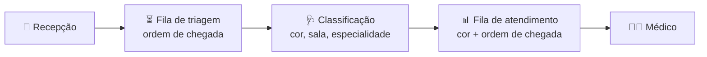

<div align="center">

# 🏥 Triagem Hospitalar

**Sistema de triagem com classificação de risco e fila de atendimento por prioridade**

Projeto da A3 de **Estrutura de Dados**


</div>

---

## 📋 Sobre o projeto

O paciente chega à recepção, espera a triagem na ordem de chegada e recebe uma **cor de risco**.
Depois entra na fila de atendimento, que chama primeiro os casos mais graves. Com a mesma cor,
quem chegou antes é atendido antes.



O projeto tem duas partes:

| Parte | Pasta | O que faz |
|---|---|---|
| 🌐 **Site** | [`html/`](html), [`css/`](css), [`js/`](js) | Telas da recepção, triagem, painel da TV e dashboard da equipe |
| ☕ **Backend** | [`backend/`](backend) | Filas em Java, menu no terminal, API HTTP e testes de desempenho |

## 🚦 Classificação de risco

| Nível | Cor | Atendimento |
|:---:|---|---|
| 1 | 🔴 **Vermelho** | Emergência |
| 2 | 🟠 **Laranja** | Muito urgente |
| 3 | 🟡 **Amarelo** | Urgente |
| 4 | 🟢 **Verde** | Pouco urgente |
| 5 | 🔵 **Azul** | Não urgente |

Quanto menor o nível, maior a prioridade.

## 🌐 Site

| Tela | Arquivo | Para quem |
|---|---|---|
| Cadastro | [`index.html`](html/index.html) | Recepção |
| Fila de triagem | [`fila-triagem.html`](html/fila-triagem.html) | Enfermagem |
| Classificação de risco | [`triagem.html`](html/triagem.html) | Enfermagem |
| Painel do paciente | [`painel-paciente.html`](html/painel-paciente.html) | TV da sala de espera |
| Dashboard | [`dashboard.html`](html/dashboard.html) | Equipe |

**Como abrir:** abra `html/index.html` no navegador ou use o Live Server do VS Code.
Hoje os dados ficam no `localStorage` do navegador.

## ☕ Backend em Java

A fila de atendimento foi feita com **três estruturas**, para comparar o desempenho:

| Estrutura | Classe Java | Inserir | Chamar próximo |
|---|---|:---:|:---:|
| Heap binário *(padrão)* | `PriorityQueue` | O(log n) | O(log n) |
| Árvore rubro-negra | `TreeSet` | O(log n) | O(log n) |
| Lista ordenada | `ArrayList` | O(n) | O(1) |

A fila de triagem é uma FIFO (`ArrayDeque`). A busca por código usa um `LinkedHashMap`, em O(1).

### Como executar

Precisa só do **JDK 17** ou mais novo.

```bash
cd backend

# Menu no terminal
javac -d out src/main/java/br/com/triagem/*.java
java -cp out br.com.triagem.Main

# API HTTP (porta 8080)
java -cp out br.com.triagem.ApiServidor

# Testes (o wrapper baixa o Maven sozinho)
./mvnw test        # Linux/Mac
mvnw.cmd test      # Windows
```

📖 Rotas da API, testes de desempenho e bugs encontrados: [**README do backend**](backend/README.md).

## 📁 Estrutura

```
triagem-hospitalar/
├── html/          telas do site
├── css/           estilos
├── js/            lógica do site (localStorage)
└── backend/
    ├── src/main/java/br/com/triagem/   filas, serviço, menu, API e benchmark
    └── src/test/java/br/com/triagem/   testes JUnit
```

## 👥 Equipe

- Andressa
- Carlos
- Gustavo
- Lorayne
